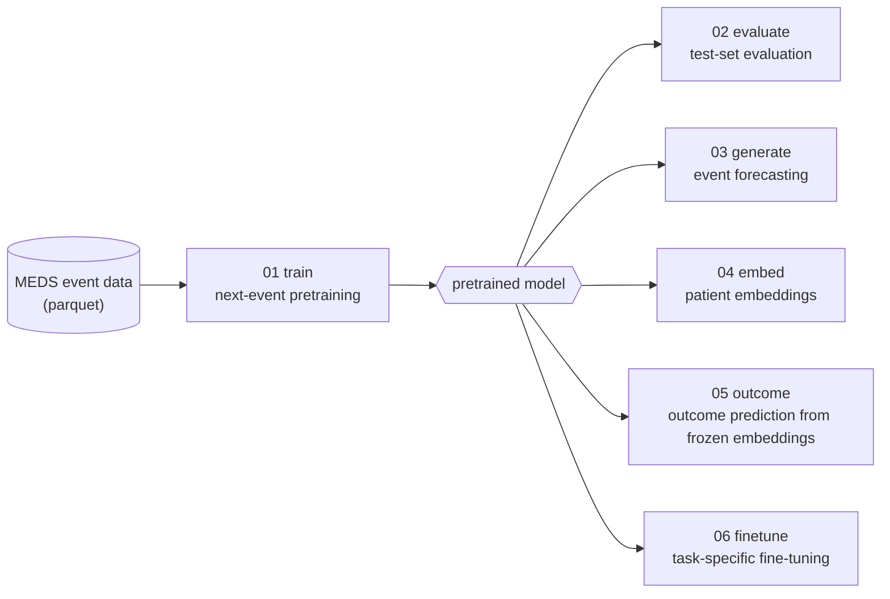

<p align="center">
  
</p>

<p align="center">
  <strong>A framework for training decoder-only transformer models on longitudinal electronic
  health records, and for applying them to event forecasting, patient representation learning
  and outcome prediction.</strong>
</p>

<p align="center">
  <a href="LICENSE"></a>
  
  
</p>

TracEHR represents each patient's record as a time-ordered sequence of clinical events
(e.g. diagnoses, prescriptions, procedures) and trains a causal transformer to predict the
next event and, optionally, the time until it occurs. The pretrained model is then used for
evaluation, autoregressive generation of future events, extraction of patient embeddings,
and prediction of binary, categorical, continuous and time-to-event outcomes.

Input data follow the [MEDS](https://medical-event-data-standard.github.io/) standard. Each
step of the workflow is a separate pipeline, run from the command line with a YAML
configuration file.

TracEHR is developed in the [Rasmussen Group](https://cbmr.ku.dk/research/research-groups/rasmussen-group/) and the PhD student Foteini Aktypi,
at the Novo Nordisk Foundation Center for Basic Metabolic Research (CBMR), University of
Copenhagen.

**Contents:** [How it works](#how-it-works) · [Key features](#key-features) ·
[Installation](#installation) · [Quick start](#quick-start) ·
[The six pipelines](#the-six-pipelines) · [Main model settings](#main-model-settings) ·
[Repository contents](#repository-contents) · [Input data specification](#input-data-specification) ·
[Token objectives](#token-objectives) · [Citing TracEHR](#citing-tracehr) · [License](#license) ·
[Authors and acknowledgements](#authors-and-acknowledgements)

## How it works



Each patient is represented as a sequence of tokens. The sequence begins with a block of
time-invariant attributes (sex and user-defined static codes, such as region), followed by
the patient's events in chronological order, each associated with its timestamp:

```
[SOS] female REGION//NORTH | F41.0 (16.99 y) -> F51.0 (17.01 y) -> N06AB04 (17.06 y) -> ...
```

The model is trained autoregressively to predict each token from the preceding context.
Event times enter the model at minute resolution, so it captures both the order of events
and the intervals between them.

## Key features

- **MEDS-native input.** MEDS parquet files are read directly. Data are streamed with
  DuckDB and training windows are constructed on the fly, without intermediate files, so
  cohorts larger than memory can be processed.
- **Continuous-time modelling.** Event times are represented at minute resolution over the
  full lifespan. Rotary position embeddings can be driven by age instead of token index, so
  that attention depends on the time elapsed between events. Optional Time2Vec embeddings
  encode age and calendar time, and an optional competing-risks time-to-event objective,
  following Delphi-2M, models the waiting time to the next event.
- **Consistent workflow.** All pipelines share the same input format, vocabulary and rule
  for truncating histories at the prediction time, so results are comparable across
  pretraining, probing and fine-tuning.
- **Outcome prediction with baselines.** Binary, continuous and survival outcomes (Cox
  models, Harrell's C-index) are predicted from frozen embeddings (pipeline 05), and
  multiclass outcomes additionally by fine-tuning (pipeline 06). Pipeline 05 compares the
  embeddings with demographics-only and bag-of-words XGBoost baselines on identical
  cross-validation folds and test set.
- **Interpretability.** Integrated gradients and occlusion attribute generated events and
  fine-tuned predictions to past events. Attention maps and an analysis of the learned token
  embeddings are also provided.
- **Data integrity.** Patient-level splits are preserved from pretraining to fine-tuning,
  cross-validation is grouped by patient, every patient record is validated with exclusions
  reported, and runs are seeded.
- **Extensible objectives.** Cross-entropy and HALO token objectives are included; further
  objectives can be added as a single module.

## Installation

Python 3.10–3.14 (3.12 recommended).

```bash
git clone https://github.com/fotiniak/tracehr.git
cd tracehr
python3.12 -m venv .venv && source .venv/bin/activate
pip install .            # pip install -e .  for development
```

- **PyTorch.** The default PyTorch wheel is built for CUDA 13 and requires a GPU of compute
  capability 7.5 or higher with a driver that supports CUDA 13. For older GPUs or drivers,
  or for CPU-only machines, install the matching build from
  [pytorch.org](https://pytorch.org/get-started/locally/) before `pip install .`. Do not use
  `pip install -U`, as it replaces the installed PyTorch build.
- **macOS.** Install `libomp` (`brew install libomp`) and set `OMP_NUM_THREADS=1`. PyTorch
  and XGBoost ship separate OpenMP runtimes, which can conflict within one process.
- **Temporary files.** DuckDB writes temporary files to `./.tmp`, which may contain patient
  data. Run TracEHR from a project or scratch directory with appropriate access controls.

## Quick start

### 1. Prepare the data

**Events.** A parquet file, or a directory of parquet files, in MEDS format with one row per
event:

| subject_id | time | code | type |
| --- | --- | --- | --- |
| 10000000 | *(null)* | `female` | demographics |
| 10000000 | *(null)* | `REGION//NORTH` | demographics |
| 10000000 | 1993-02-22 00:00:00 | `MEDS_BIRTH` | demographics |
| 10000000 | 2010-02-19 01:33:14 | `F41.0` | diagnosis |
| 10000000 | 2010-03-17 21:17:20 | `N06AB04` | medication |

- Each patient requires a birth row (here `MEDS_BIRTH`), which defines the time origin; all
  times are measured relative to it.
- Sex and static codes (here `female` and `REGION//NORTH`) may have a null timestamp.
- `type` is an optional additional column. All other columns, including `numeric_value`,
  are ignored.

**Patient splits.** Three single-column parquet files with the patient identifiers of the
training, validation and test sets.

**Anchors and outcomes** (pipelines 03–06). One row per prediction: the patient identifier,
the anchor timestamp (the time at which the prediction is made) and, for pipelines 05 and
06, the target (binary, categorical or continuous). Survival outcomes require a binary event
indicator and a column with the event or censoring timestamp.

The full rules are given in [Input data specification](#input-data-specification).

### 2. Configure

```bash
mkdir my_configs && cp configs/*.yaml my_configs/
```

`configs/` contains one template per pipeline, with every setting documented inline. Every
command requires `--config`. Set the input and output paths (`parquet_path`, the split
files, `vocab_path`, `output_dir`) and the column names. The example paths in the templates
are placeholders; no data are distributed with TracEHR.

### 3. Pretrain

```bash
tracehr-train --config my_configs/01_train_model.yaml
```

This builds the vocabulary, trains the model with validation after every epoch, and writes
`best_model.pt`, `latest.pt`, `training_history.json` and training curves to `output_dir`.

### 4. Run the downstream pipelines

Set `checkpoint.model_path` (pipeline 06: `checkpoint.pretrained_checkpoint_path`) to
`best_model.pt`, then run:

```bash
tracehr-evaluate  --config my_configs/02_evaluate_model.yaml
tracehr-generate  --config my_configs/03_generate_tokens.yaml
tracehr-embed     --config my_configs/04_extract_embeddings.yaml
tracehr-outcome   --config my_configs/05_outcome_probe_prediction.yaml
tracehr-finetune  --config my_configs/06_finetune_model.yaml
```

## The six pipelines

| Pipeline | Description | Main outputs |
| --- | --- | --- |
| **01** `tracehr-train` | Pretrains the transformer on next-event prediction, optionally with a time-to-event objective. | `best_model.pt`, `latest.pt`, `vocabulary.json`, `training_history.json`, training curves |
| **02** `tracehr-evaluate` | Evaluates the model on the test set (loss, perplexity, accuracy, top-k accuracy, mean reciprocal rank, and time-to-event error where applicable) and analyses the learned token embeddings. | `test_metrics.json`, `test_metrics.png`, `token_embeddings/` |
| **03** `tracehr-generate` | Truncates each history at its anchor and generates the next 1–20 events autoregressively, comparing them with the observed continuation; optional attribution of each generated event. | `generations.parquet`, optional `explainability_plots/` |
| **04** `tracehr-embed` | Extracts a patient embedding at the anchor, or along a time grid to obtain embedding trajectories. | `anchor_embeddings.parquet`, `embedding_extraction_meta.json` |
| **05** `tracehr-outcome` | Predicts outcomes from frozen embeddings and compares six models with cross-validation and on the test set: demographics only; embeddings with and without demographics, each with a linear model and with XGBoost; and bag-of-words with demographics in XGBoost. | `outcome_summary.json`, `downstream_metrics.json`, `downstream_embeddings.parquet`, ROC/PR and other plots |
| **06** `tracehr-finetune` | Fine-tunes the model with a task-specific head (binary, multiclass, regression or survival), training the head only, the full model, or both in two phases; optional attribution. | `best_model.pt`, `test_metrics.json`, `predictions.parquet`, `explainability/` |

**Anchors.** Pipelines 03–06 truncate each patient's history at the anchor time (minus
`time_before_event` days), so that only information available at the prediction time is
used. A patient may have several anchors. Whether an event recorded exactly at the anchor is
retained is controlled by `remove_cutoff_token` (see the configuration templates).

**Programmatic use.** Each pipeline can also be run as a Python module or called from
Python:

```bash
python -m tracehr.pipelines.train_model --config my_configs/01_train_model.yaml
```

```python
from tracehr.pipelines import train_model
train_model.main("my_configs/01_train_model.yaml")
```

## Main model settings

The principal settings in `01_train_model.yaml`:

| Setting | Description |
| --- | --- |
| `model.d_model`, `model.n_layers`, `model.n_heads` | embedding dimension, number of layers and number of attention heads |
| `model.max_seq_len` | context length in tokens |
| `model.rope_mode` | position encoding in attention: `index` (token position), `age` (time since birth) or `hybrid` (both) |
| `model.use_time_age`, `model.use_time_abs` | Time2Vec embeddings of age and of calendar time |
| `model.use_type` | embedding of the event `type` column |
| `model.t2e_weight` | weight of the time-to-event loss (`0` disables it) |
| `model.loss_mode` | token objective: `cross_entropy` or `halo` (see [Token objectives](#token-objectives)) |
| `sequences.sex_tokens`, `sequences.static_tokens` | codes placed at the start of every sequence |

## Repository contents

```
configs/            one configuration template per pipeline
src/tracehr/
├── dataset/        MEDS reader, vocabulary, windowing, streaming datasets
├── ntp_model/      the transformer: attention, RoPE, Time2Vec, token objectives
├── training/       training loop and validation
├── generation/     evaluation, generation, attribution
├── probing/        embedding extraction, outcome models and baselines
├── finetuning/     task heads, survival analysis, interpretability
└── pipelines/      entry points of the six pipelines
pyproject.toml      package metadata, dependencies and command-line entry points
README.md           this document
CITATION.cff        citation metadata
LICENSE             Apache License 2.0
NOTICE              copyright and attribution notices (to be retained on redistribution)
logo.svg            TracEHR logo
```

## Input data specification

### Columns

The input is [MEDS](https://medical-event-data-standard.github.io/docs/intro_pages/what_is_MEDS/#meds-data-file-specification)
data without the metadata files: a parquet file or a directory of parquet shards (read
recursively), with one row per event. Column names are set in the `columns:` block of each
configuration and validated at startup.

| Config key | MEDS column | Type | Rule |
| --- | --- | --- | --- |
| `id_col` | `subject_id` | integer or string | never null |
| `tok_col` | `code` | string | never null |
| `timestamp_col` | `time` | `timestamp[us]` without time zone | null only for sex and static tokens |
| `type_col` | none (additional column) | string | optional (`null` disables it) |

`numeric_value` and all other columns are ignored.

### Time

- `time_age` = (timestamp − birth) / 1 day;
- `time_abs` = (timestamp − 1900-01-01) / 1 day (`EARLIEST_TIMESTAMP` in
  `src/tracehr/dataset/meds_reader.py`).

All time settings in the configuration files (e.g. `time_before_event`, `timestep`) and all
reported times are in days. Times are stored in float64 and resolved to the minute
throughout the model.

### Birth token

`sequences.birth_token` (e.g. `MEDS_BIRTH`, required) identifies each patient's birth row.
It defines the time origin and is not part of the vocabulary.

### Sex and static tokens

`sequences.sex_tokens` and `sequences.static_tokens` define the tokens placed at the start of
every sequence: `[SOS, sex token, static tokens..., events...]`.

- Static tokens must be time-invariant and known at birth; timed occurrences of a static
  code are moved into this block. The block is visible at every anchor and must not contain
  outcome-derived information.
- The sex token comes first, followed by the patient's static tokens in alphabetical order.
  They are assigned the birth time and are never prediction targets.
- The block holds at most 10 positions (start token, sex token and up to 8 static tokens);
  additional static tokens are dropped and reported.
- All listed tokens are included in the vocabulary, even if absent from the training data.

### Data validation

Each run validates every patient once and reports the exclusions:

- **Rows** are excluded if they lack a patient identifier or a code, or have a null
  timestamp for a code that is not a sex or static token.
- **Patients** are excluded if they have no valid birth timestamp, conflicting birth
  timestamps, a birth before 1900-01-01, or an event before birth.

### Anchors and outcomes

Anchor times (`anchor_columns.timestamp_col`, `timestamp[us]`) are converted to age using the
same birth rows as the events. For survival outcomes, `anchor_columns.censor_timestamp_col`
gives the event time (target 1) or the censoring time (target 0). Durations are computed in
days from the anchor; rows with a missing duration or one preceding the anchor are excluded
and reported.

## Token objectives

The token objective is selected with `model.loss_mode`:

| `loss_mode` | Module | Description |
| --- | --- | --- |
| `cross_entropy` (default) | `ntp_model/cross_entropy.py` | next-token cross-entropy |
| `halo` | `ntp_model/halo.py` | distance-to-centroid logits with an abstain class and a radial prior ([4rtemi5/halo](https://github.com/4rtemi5/halo)) |

To add an objective:

1. Implement `src/tracehr/ntp_model/<name>.py` following the contract documented on
   `CrossEntropyTokenLoss` in `cross_entropy.py`.
2. Import it in `ntp_transformer.py` and add it to the `TOKEN_LOSSES` registry.
3. Set `model.loss_mode: "<name>"` in the training configuration.

No other code changes are required.

## Citing TracEHR

If you use TracEHR in your research, please cite it. On GitHub, the **"Cite this
repository"** button (from [CITATION.cff](CITATION.cff)) provides APA and BibTeX formats.
Alternatively:

```bibtex
@software{aktypi_tracehr_2026,
  author  = {Aktypi, Foteini},
  title   = {{TracEHR}: Autoregressive Transformer Training \& Inference for Electronic Health Records},
  year    = {2026},
  version = {0.1.0},
  url     = {https://github.com/fotiniak/tracehr},
  note    = {Rasmussen Group, Novo Nordisk Foundation Center for Basic Metabolic Research (CBMR), University of Copenhagen}
}
```

## License

TracEHR is released under the [Apache License 2.0](LICENSE).
Copyright 2026 University of Copenhagen.

The license permits use, modification and redistribution, including for commercial
purposes, provided that the copyright notice and the [NOTICE](NOTICE) file are retained and
modified files are marked as changed.

## Authors and acknowledgements

TracEHR is written by Foteini Aktypi
([ORCID 0000-0003-3209-4286](https://orcid.org/0000-0003-3209-4286)) in the
[Rasmussen Group](https://cbmr.ku.dk/research/research-groups/rasmussen-group/) at the
Novo Nordisk Foundation Center for Basic Metabolic Research (CBMR), University of
Copenhagen.

TracEHR builds on:

- [MEDS](https://medical-event-data-standard.github.io/), the Medical Event Data Standard,
  which defines the input format;
- Delphi-2M, whose time-to-event formulation TracEHR follows: Shmatko et al., "Learning the
  natural history of human disease with generative transformers", *Nature* (2025),
  [doi:10.1038/s41586-025-09529-3](https://doi.org/10.1038/s41586-025-09529-3);
- [4rtemi5/halo](https://github.com/4rtemi5/halo), from which the HALO objective is adapted.
